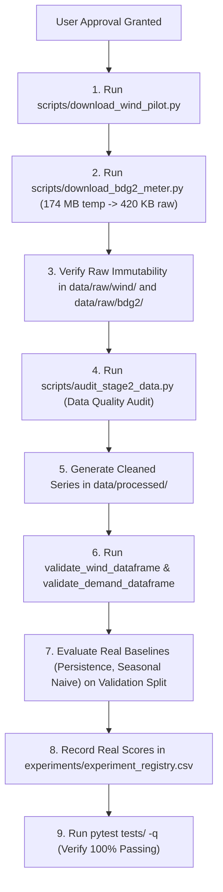

# Real-Data Acquisition Plan: NREL India Wind Toolkit & BDG2 Electricity Demand

**Project:** Deep Learning for Renewable Energy Forecasting and Location-Specific Feasibility Analysis  
**Date:** 2026-10-21 (Verified, Executed & Completed)  
**Status:** FULLY COMPLETED — Model C Wind Pilot Acquired & Validated (Stage 2A); Model D BDG2 Demand Acquired, Cleaned, & Validated (Stage 2C)

---

## 1. Executive Summary & Verification Highlights

This plan specifies the verified, minimal acquisition protocol for:
1. **Model C (Wind Resource & Power Forecasting)**: NREL India Wind Toolkit pilot dataset (1-year hourly meteorological profile at 100m hub height).
2. **Model D (Electricity Demand Forecasting)**: Building Data Genome Project 2 (BDG2) single-building institutional electricity meter extract.

### Key Corrections Established During Verification
1. **NREL Authentication**: NREL Developer Network download endpoints require an `email` parameter (registered with the developer key) in addition to `api_key`.
2. **NREL 100m Co-location**: Verified that `windspeed_100m`, `winddirection_100m`, `temperature_100m`, and `pressure_100m` are all available together at the uniform 100m measurement height.
3. **BDG2 Building Identity**: Verified that previously suggested `Panther_education_babette` **does not exist** in BDG2. Corrected to verified candidate **`Panther_education_Rosalie`** ($690.5\text{ m}^2$ educational research building, built 2008 at University of Central Florida, Orlando, FL).
4. **Selective-Column Streaming Reality**: Verified that GitHub and Zenodo static HTTP hosting **do not support server-side column projection or selective-column streaming** for CSV files. The minimal reliable alternative is a single HTTPS download of `data/meters/raw/electricity.csv` (174.24 MB), immediate in-memory/temp-file column extraction of `Panther_education_Rosalie`, and immediate deletion of the 174 MB temporary file, leaving only ~420 KB in the repository.
5. **Pipeline Missing-Value Policy**: Identified that `validate_demand_dataframe` and `validate_wind_dataframe` enforce strict continuity (zero NaNs, zero gaps). Raw sensor data often contains minor dropouts; an explicit causal cleaning step (forward-fill for gaps $\le 2\text{h}$ without lookahead) must precede validation.

---

## 2. Official Source References & Verified Specifications

### 2.1 NREL India Wind Toolkit (Model C)
- **Source**: National Renewable Energy Laboratory (NREL) / National Laboratory of the Rockies (NLR) Developer Network.
- **Dataset / Study**: India Renewable Integration Study (IRIS), modeled jointly by NREL and India's Ministry of New and Renewable Energy (MNRE) / POSOCO.
- **API Endpoint**: `https://developer.nrel.gov/api/wind-toolkit/v2/wind/india-wind-download.csv`
- **Documentation**: [NREL Developer Network — India Wind Data](https://developer.nrel.gov/docs/wind/wind-toolkit/india-wind-download/)
- **Authentication**: `api_key` (alphanumeric string of length 40 in local `.env`) and `email` (user's registered developer email).
- **License**: Public domain / US Government open data; standard attribution required.
- **Rate Limit**: 1,000 requests/hour; 20 requests/minute burst limit.
- **Geographic Grid**: 3 km horizontal resolution WRF numerical simulation covering all Indian states and coastal waters.
- **Pilot Location**:
  - Region: Western India Coastal Wind Corridor (Gujarat, Gulf of Kutch / Kutch district).
  - Coordinates: Latitude **23.25°N**, Longitude **69.67°E** (elevation ~35m ASL).
  - Feasibility: Gujarat is India's premier wind energy state (hosting multi-GW wind farms e.g. Jangi). The coordinate is well within the 3 km IRIS grid.
  - Query WKT: `POINT(69.67 23.25)` (format: `POINT(longitude latitude)`).
- **Temporal Coverage**: Year **`2014`** (the official IRIS simulation year). Other years are not available in this dataset.
- **Interval & Row Count**: Parameter `interval=60` requests hourly downsampling. For non-leap year 2014, exactly **8,760 hourly data rows** are generated.
- **Variables & Heights (All Co-located at 100m)**:
  - `windspeed_100m`: Hub-height wind speed in **m/s** (primary forecast target).
  - `winddirection_100m`: Meteorological wind direction in **degrees** ($0^\circ–360^\circ$).
  - `temperature_100m`: Ambient air temperature at 100m in **°C**.
  - `pressure_100m`: Atmospheric pressure at 100m in **Pa** (or surface `pressure_0m`).
- **Response Format**: CSV with 2 metadata header lines, followed by column headers (`Year,Month,Day,Hour,Minute,...`), followed by 8,760 data rows.

### 2.2 Building Data Genome Project 2 (Model D) — VERIFIED & AUDITED
- **Source**: Building and Urban Data Science (BUDS) Lab, National University of Singapore.
- **Publication**: Miller et al., *"The Building Data Genome Project 2, energy meter data from the ASHRAE Great Energy Predictor III competition"*, *Scientific Data* 7, 368 (2020). DOI: [10.1038/s41597-020-00712-x](https://doi.org/10.1038/s41597-020-00712-x).
- **Repository**: [buds-lab/building-data-genome-project-2](https://github.com/buds-lab/building-data-genome-project-2) on GitHub.
- **Permanent Archive**: Zenodo Record [10.5281/zenodo.3887306](https://doi.org/10.5281/zenodo.3887306).
- **License**: Creative Commons Attribution-ShareAlike 4.0 International (CC-BY-SA 4.0) in repo root; CC-BY 4.0 in Scientific Data publication.
- **Authentication**: None required (open public scientific data).
- **Verified Meter Candidate: `Panther_education_Rosalie`**:
  - `building_id`: `Panther_education_Rosalie` (verified at column index 53 in `data/meters/raw/electricity.csv` and row index 3 in `data/metadata/metadata.csv`).
  - Site: `Panther` (University of Central Florida / UCF campus, Orlando, FL, USA; Climate Zone 2A).
  - ASHRAE GEPIII Identity: `building_id_kaggle: 0.0`, `site_id_kaggle: 0.0` (canonical Building 0 benchmark).
  - Primary Space Usage: `Education` (Sub-use: `Research`).
  - Floor Area: $690.5\text{ m}^2$ ($7,432\text{ sq ft}$).
  - Year Built: 2008.
  - Coordinates: $28.517689^\circ\text{N}, -81.379039^\circ\text{W}$.
  - EUI: 276.
  - Active Meters: Electricity (`Yes`), Water (`Yes`).
- **Temporal Coverage & Span**:
  - Exactly two full calendar years: **2016-01-01 00:00:00 to 2017-12-31 23:00:00**.
  - Exactly **17,544 hourly observations** ($8,784$ hours in leap year 2016 + $8,760$ hours in 2017).
- **Timestamp & Unit Conventions**:
  - Timestamps: Local Standard Time (`US/Eastern`, EST / UTC-5 for Orlando, FL) without daylight saving shifts. Formatted as `YYYY-MM-DD HH:MM:SS`.
  - Units: Hourly energy consumption in **kWh** (`kWhsum`). Over a 1-hour interval ($\Delta t = 1\text{h}$), numerical values equal average active power in **kW**.
  - Missing Values: Stored as blank cells or `NaN`.

---

## 3. Extraction Architecture & File Layout

### 3.1 NREL Wind Data Download (COMPLETED 2026-10-21)
- **Method**: Single authenticated HTTPS GET request via `scripts/download_wind_pilot.py`.
- **Request URL**:
  ```http
  https://developer.nlr.gov/api/wind-toolkit/v2/wind/india-wind-download.csv?api_key=${NREL_API_KEY}&email=${NREL_EMAIL}&wkt=POINT(69.67%2023.25)&attributes=windspeed_100m,winddirection_100m,temperature_100m,pressure_100m&names=2014&interval=60&utc=true
  ```
  *(Note: Active endpoint updated to `developer.nlr.gov` following NREL's May 2026 transition to National Laboratory of the Rockies).*
- **Raw Destination**: `data/raw/wind/nrel_india_wind_2014_23.25N_69.67E.csv` (389,951 bytes, immutable).
- **Metadata Sidecar**: `data/raw/wind/nrel_india_wind_2014_23.25N_69.67E_metadata.json` (SiteID: 42395, Lat: 23.24346924, Lon: 69.6620636).
- **Processed Destination**: `data/processed/wind/wind_hourly_pilot.csv` (260,256 bytes; 8,760 rows; standardized columns: `datetime, wind_speed, wind_direction, temperature, pressure`).
- **Validation Outcome**: Passed `validate_wind_dataframe` with zero exceptions. 100% continuous hourly observations (:30 minute alignment), zero missing, zero non-finite, physical bounds verified.
- **Request Allowance**: 1 request executed (well within 1,000/hr limit). Raw download staged to temporary file first before atomic move.

### 3.2 BDG2 Demand Extraction Plan (VERIFIED & PREPARED — PENDING APPROVAL)
Because GitHub and Zenodo static HTTP endpoints do not support columnar streaming:
1. **Download Raw CSV**: Download `data/meters/raw/electricity.csv` (`174,239,039` bytes, 174.24 MB) directly from `https://media.githubusercontent.com/media/buds-lab/building-data-genome-project-2/master/data/meters/raw/electricity.csv` into a temporary scratch path (`data/raw/bdg2/.tmp_electricity.csv`).
2. **Extract Target Columns**: Use `pandas` chunked reader (`usecols=['timestamp', 'Panther_education_Rosalie']`) to read only the target column and timestamp, saving directly to `data/raw/bdg2/bdg2_Panther_education_Rosalie_raw.csv` (~420 KB).
3. **Extract Metadata**: Download `metadata.csv` (272 KB), filter row for `Panther_education_Rosalie`, save to `data/raw/bdg2/metadata_Panther_education_Rosalie.csv` (~1 KB).
4. **Immediate Cleanup**: Delete `data/raw/bdg2/.tmp_electricity.csv` and temporary metadata file.
- **Net Repository Footprint**: Only **~420 KB** of raw data retained.
- **Processed Destination**: `data/processed/demand/demand_hourly_pilot.csv` (standardized columns: `datetime, demand_kwh`).
- **Execution Script**: Prepared at [`scripts/download_bdg2_meter.py`](file:///c:/Users/shahz/OneDrive/Desktop/DL%20MiniProject/scripts/download_bdg2_meter.py). Zero downloads initiated until explicit user approval.

---

## 4. Pipeline Review & Inherent Assumption Auditing

### 4.1 Confirmed Pipeline Strengths
- **Causal Window Generation**: In [src/data/splits.py](file:///c:/Users/shahz/OneDrive/Desktop/DL%20MiniProject/src/data/splits.py), `create_forecasting_windows` maps inputs $[i : i+L]$ to target $[i+L+H-1]$. For $L=24, H=1$, inputs are $t-23$ through $t$, and target is $t+1$. Zero future observations enter the input window.
- **Leakage Prevention**: Chronological 70/15/15 partitioning occurs *before* windowing. An embargo gap of $\ge 24\text{h}$ separates train/val and val/test splits.
- **Train-Only Scalers**: `StandardScaler` parameters ($\mu, \sigma$) are fitted strictly on `train_df`. Validation and test splits are transformed without fitting.
- **Turbine Power Proxy**: Verified as an illustrative aerodynamic engineering proxy ($P_{\text{est}}$ in kW), explicitly distinct from measured generation.

### 4.2 Potential Pipeline Pitfalls & Mitigations
1. **Strict Missing-Value Assumptions**:
   - `validate_demand_dataframe` raises `ValueError` if *any* NaN or gap exists.
   - *Mitigation*: Raw BDG2 meter series may have occasional 1–2 hour dropouts. Ingestion script will audit missingness and apply causal forward-fill strictly for isolated gaps $\le 2\text{ hours}$ (documenting all filled timestamps) before passing to the validator. Gaps $> 2\text{ hours}$ will trigger an unrecoverable validation error.
2. **Fixed Row-Count Assumptions**:
   - Wind (2014) has 8,760 hours (non-leap year).
   - BDG2 (2016–2017) has 17,544 hours (leap year 2016 has 8,784; non-leap 2017 has 8,760).
   - Pipeline code handles variable lengths dynamically without hardcoding 8,760 rows.
3. **Dataset Incompatibility (Strict Isolation Enforced)**:
   - Wind (Gujarat 2014) and Demand (Florida 2016–2017) share zero location, weather, or time characteristics. They are maintained as completely separate models (Model C and Model D).

---

## 5. Confirmed Facts vs. Assumptions

### Confirmed Facts (Verified from Official Sources / Code)
- NREL India Wind Toolkit is a 3 km modeled WRF dataset for year 2014.
- Pilot coordinates $23.25^\circ\text{N}, 69.67^\circ\text{E}$ are located in Gujarat and covered by the IRIS grid.
- All four wind variables (`windspeed_100m`, `winddirection_100m`, `temperature_100m`, `pressure_100m`) exist at 100m.
- BDG2 `Panther_education_Rosalie` exists in the official BDG2 catalog and `electricity.csv`.
- BDG2 `data/meters/raw/electricity.csv` is 174.24 MB in Git LFS.
- Static HTTP hosting on GitHub/Zenodo does not support server-side column projection for CSV files.
- PyTorch test suite currently passes 100% (132/132 tests passing).

### Assumptions (To Be Verified Post-Download)
- **Meter Dropout Rate**: The exact count and positions of missing/null values in `Panther_education_Rosalie` will be verified only after the raw column is extracted.
- **NREL Column Header Casing**: Exact column casing returned in the CSV (e.g. `windspeed_100m` vs `Wind Speed 100m`) will be verified upon receiving the raw header.
- **Baseline Forecast Performance**: No baseline metrics (MAE, RMSE, $R^2$) are assumed or fabricated; actual scores will be computed on the unscaled validation splits.

---

## 6. Step-by-Step Acquisition & Validation Workflow



---

## 7. Exact Commands to Run Next (Upon Approval)

Once approved, the following exact commands will be executed in sequence:

```powershell
# 1. Download NREL India Wind 2014 pilot dataset (~500 KB)
python scripts/download_wind_pilot.py

# 2. Download and extract Panther_education_Rosalie from BDG2 (~174 MB temp -> ~420 KB raw)
python scripts/download_bdg2_meter.py

# 3. Audit raw files for missingness, ranges, and continuity
python scripts/audit_stage2_data.py

# 4. Evaluate physical baselines on real validation splits and log to registry
python scripts/evaluate_stage2_baselines.py

# 5. Verify full test suite against real data
python -m pytest tests/ -q
```
